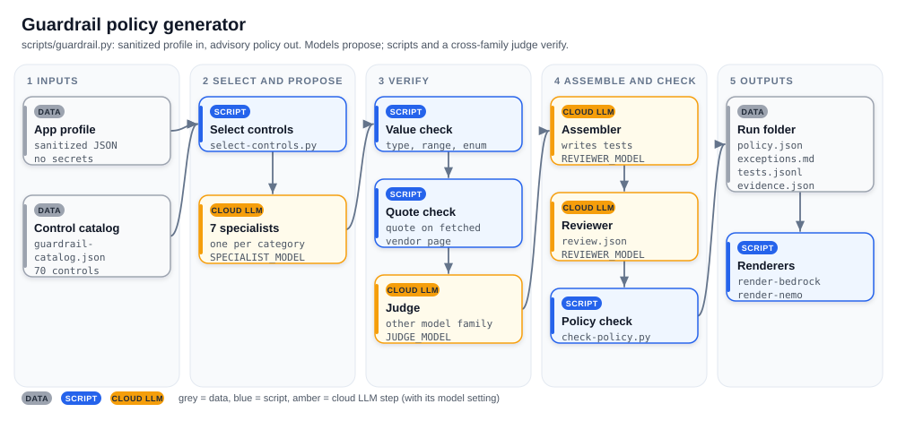

# grounded-ai-guardrails

Draft AI guardrail policies where every vendor-backed value is tied to a quote from an official page, and answer Prisma Cloud / Cortex Cloud questions with source-cited briefings.

> Independent project. Not affiliated with Palo Alto Networks, Docker, NVIDIA, AWS, OWASP or MITRE. Formerly `docker-agent-prisma-cortex`; old GitHub links redirect here.

## Why

LLM-written security settings often look plausible but cannot be traced to any source. This project lets models propose values, then keeps only the ones that survive three checks:

1. a script confirms the quoted text is really on the cited vendor page,
2. a script checks the value's type, range and allowed options,
3. a judge model from a different family confirms the quote supports the value.

Everything else is clearly labeled as a catalog default, an opinionated baseline that is not vendor-backed.

## What you get

| Tool | Input | Output |
|---|---|---|
| Guardrail policy generator (`scripts/guardrail.py`) | A sanitized app profile (RAG, tools, memory, PII, autonomy...) | `policy.json`, tests, an exceptions report, Amazon Bedrock and NVIDIA NeMo drafts |
| Docs briefing (`scripts/run.sh`) | A Prisma Cloud / Cortex Cloud question | A short briefing in which every statement cites an official page |

Both run on [docker-agent](https://github.com/docker/docker-agent) with Ollama cloud models and share the same quote check and judge.

## Requirements

- `bash`, `curl`, `python3` 3.9+ (standard library only, nothing to `pip install`)
- [docker-agent](https://github.com/docker/docker-agent/releases) 1.152+
- [Ollama](https://ollama.com/download), signed in with `ollama signin`, and internet access

Models run on Ollama cloud only (names end in `:cloud` or `-cloud`); nothing is downloaded. A startup guard refuses local models (exit 64) unless `ALLOW_LOCAL_MODELS=1`. Prompts and profiles are sent to ollama.com: use sanitized profiles only, with no secrets, customer or tenant data.

## Try it in one minute (no model calls)

```bash
git clone https://github.com/arifbazli/grounded-ai-guardrails.git
cd grounded-ai-guardrails
cp .env.example .env
python3 -m unittest discover -s tests
python3 scripts/guardrail.py --no-llm bench/guardrail/rag-chatbot.profile.json
ls "$(cat outputs/.last-guardrail)"
```

`--no-llm` selects the controls for the profile and fills them with catalog defaults, then writes tests, renders the Bedrock and NeMo drafts and runs `scripts/check-policy.py`. `--dry-run` prints the selected controls and specialist prompts instead.

Run with models:

```bash
python3 scripts/guardrail.py bench/guardrail/rag-chatbot.profile.json
scripts/run.sh "Why migrate from Prisma Cloud to Cortex Cloud?"
```

A guardrail run takes several minutes per profile; a briefing takes a few minutes.

## How the guardrail generator works



| Amber step | Model setting |
|---|---|
| Specialists | SPECIALIST_MODEL |
| Judge | JUDGE_MODEL |
| Assembler and reviewer | REVIEWER_MODEL |

Scripts choose the controls from a 70-control catalog and verify every quote. Models only propose values and write tests. More diagrams: [docs/architecture.md](docs/architecture.md). Step-by-step details: [docs/guardrail-generator.md](docs/guardrail-generator.md).

## Evidence tiers

Every control in `policy.json` has one tier:

| Tier | Meaning |
|---|---|
| `grounded` | At least one value has a vendor quote found on the page and judged SUPPORTED; each such value records its `source_kind`. |
| `catalog-default` | Values are the catalog's recommended defaults: an opinionated baseline, not vendor-backed. |
| `excluded` | The control does not apply to this profile; the reason is recorded. |

A value with `source_kind: example-config` comes from a vendor example block. It is an example, not a recommendation.

## Example output

Trimmed from a live run on the `rag-chatbot` golden profile. One control from `policy.json`:

```json
{
  "control_id": "INPUT-10",
  "name": "Injection screening",
  "tier": "grounded",
  "parameters": [
    {
      "name": "prompt_attack_strength",
      "value": "LOW",
      "basis": "vendor-grounded",
      "source_kind": "documented-limit-or-enum",
      "source_url": "https://docs.aws.amazon.com/bedrock/latest/userguide/guardrails-content-filters.html",
      "source_quote": "Select None, Low, Medium, or High for the level of filtration you want to apply to each category."
    },
    {
      "name": "injection_action",
      "value": "reject",
      "basis": "catalog-default",
      "label": "opinionated baseline, not vendor-backed"
    }
  ]
}
```

The summary from the same run's `exceptions.md`:

```text
| Tier | Controls |
|---|---|
| grounded (quote verified on the vendor page and judged SUPPORTED) | 9 |
| catalog-default (catalog baseline values only, NOT vendor-backed) | 38 |
| excluded (not applicable to this profile) | 23 |
```

## Measured results

Grounded controls out of selected controls across all 12 runs in [bench/guardrail/results.tsv](bench/guardrail/results.tsv) (4 per golden profile, default models):

| Golden profile | Selected | Grounded (min-max) |
|---|---|---|
| `rag-chatbot` | 47 of 70 | 4-12 |
| `tool-agent` | 36 of 70 | 3-7 |
| `memory-assistant` | 45 of 70 | 3-11 |

Results vary between runs, and most of every policy is `catalog-default`.

## Output files

Each run writes `outputs/<timestamp>-guardrail-<profile>/`; `outputs/.last-guardrail` holds the latest path.

| File | Content |
|---|---|
| `policy.json` | Controls with tiers, values, sources and source kinds |
| `exceptions.md` | Tier counts, waivers, catalog-default controls, dropped proposals |
| `tests.jsonl` | At least one test case per selected control |
| `evidence.json` | Counts, verdicts, timings and the `check-policy.py` result |
| `review.json` | Reviewer findings (empty with `--no-llm`) |
| `bedrock-guardrail.json`, `bedrock-report.md` | Amazon Bedrock Guardrails draft and what could not be rendered |
| `nemo-config.yml`, `nemo-report.md` | NVIDIA NeMo Guardrails draft and what could not be rendered |

## Docs briefing

A researcher model extracts facts with quotes from official Palo Alto Networks pages, a script checks each quote, a judge checks support, and a writer uses supported facts only.

```bash
scripts/run.sh "Why migrate from Prisma Cloud to Cortex Cloud?"
```

Configs, Docker, output and exit codes: [docs/docs-briefing.md](docs/docs-briefing.md). The read-only tenant assistant is experimental and untested against a live tenant ([details](docs/docs-briefing.md#tenant-assistant-experimental)).

## Settings

Set in `.env` or on the command line (the command line wins). Main defaults:

| Variable | Default |
|---|---|
| `SPECIALIST_MODEL` | `nemotron-3-nano:30b-cloud` |
| `JUDGE_MODEL` | `gpt-oss:120b-cloud` |
| `REVIEWER_MODEL` | `nemotron-3-super:cloud` |
| `RESEARCH_MODEL` / `WRITER_MODEL` | `nemotron-3-super:cloud` |
| `OLLAMA_BASE_URL` | `http://localhost:11434/v1` |

Full list: [docs/settings.md](docs/settings.md).

## Development

`agents/*.yaml` are generated; never edit them by hand. Edit the sources:

- Guardrail generator: `templates/guardrail-agent.yaml.tmpl`, `templates/scopes/guardrail-*.txt`, `seeds/guardrail-catalog.json`, `schemas/`
- Docs briefing: `templates/agent.yaml.tmpl`, `templates/scopes/*-hub.txt`, `seeds/*.txt`
- Diagrams: `scripts/make-diagrams.py` (writes `docs/images/*.svg`)

Then regenerate and check (no model calls):

```bash
python3 scripts/gen-configs.py
python3 scripts/make-diagrams.py
python3 -m unittest discover -s tests
bench/guardrail/check-golden.sh
```

Live benchmarks: `bench/guardrail/run-live.sh` and `bench/run-all.sh`. Compare new rows in the `results.tsv` files with earlier ones before merging.

## Limitations

- Output is advisory. A human must review every control, value and test before use.
- Grounding varies between runs; treat a run as a draft.
- The judge can pass weak values; the value checks reduce this but do not remove it.
- A partly supported proposal is dropped, not partly applied.
- Bedrock denied topics need human-written definitions.
- MITRE ATLAS links point to the site root.
- Prisma AIRS grounding is thin.

Roadmap: extract enums and ranges from vendor API schemas; make the tenant assistant template cloud-only.

## License

[MIT](LICENSE)
