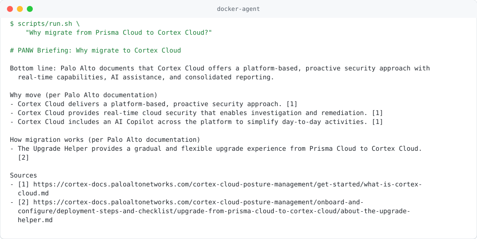

# docker-agent-prisma-cortex

> Independent research project. Not affiliated with or endorsed by Palo Alto Networks or Docker.

A [docker-agent](https://github.com/docker/docker-agent) multi-model workflow that answers Palo Alto Networks questions, mainly **Prisma Cloud to Cortex Cloud migration**, from official documentation only. Every claim in a briefing is tied to a quote, and a script checks that each quote really is on the page the researcher fetched.

## Quick start

```bash
cp .env.example .env            # models and Ollama URL; edit if needed
ollama signin                   # ":cloud" models run on ollama.com
scripts/run.sh "Why migrate from Prisma Cloud to Cortex Cloud?"
```

A run takes about 1-3 minutes. The briefing is printed and saved to `outputs/<run>.md`, with an evidence file next to it (`outputs/<run>.evidence.json`: every fact, its quote, verdict and the pages fetched).

Cortex Cloud-only agent:

```bash
CFG=agents/cortex-cloud-hub.yaml scripts/run.sh "What does Cortex Cloud AI-SPM monitor?"
```

### With Docker

```bash
docker compose build
docker compose run --rm agent "How do I link a Prisma Cloud tenant to Cortex Cloud?"
```

The container talks to Ollama on the host (`host.docker.internal:11434`). To run Ollama in a container too, see the comments in [`compose.yaml`](compose.yaml). CI publishes the image to `ghcr.io/arifbazli/docker-agent-prisma-cortex` on every push to `main`.

### Prerequisites

- [`docker-agent`](https://github.com/docker/docker-agent/releases) v1.152.0 or later (bundled in the Docker image)
- [Ollama](https://ollama.com) with access to the models in `.env`. **`:cloud` models run on ollama.com, not locally**: they need `ollama signin` and network access. The disk footprint is small, but this does not work offline. For offline use, set local models in `.env`.
- `bash`, `curl`, `python3` (3.9+, standard library only)

## Example run

<picture>
  <source media="(prefers-color-scheme: dark)" srcset="docs/images/docker-agent-run-dark.svg">
  
</picture>

## How it works

```
question -> researcher (LLM) -> quote check (script) -> judge (LLM) -> writer (LLM) -> briefing
```

| Step | Default model | Job |
|---|---|---|
| researcher | `nemotron-3-super:cloud` | Fetches documentation pages, extracts facts with exact quotes |
| quote check | none (Python) | Checks each quote against the exact page text the researcher received; rejects `?ask=` URLs, pages not fetched in this run, and 404s |
| judge | `gpt-oss:120b-cloud` | Only decides whether a verified quote supports its fact. A different model family from the researcher, so it does not share its blind spots |
| writer | `nemotron-3-super:cloud` | Writes the briefing from SUPPORTED facts only |

[`scripts/pipeline.py`](scripts/pipeline.py) runs each step as a separate `docker-agent run --exec --json` call and reads the event stream, so:

- no LLM relays text between agents (nothing gets summarised or dropped on the way);
- pages are fetched once; the quote check uses the same text the researcher saw, saved under `fetched/`;
- a crash in any step gives `BRIEFING FAILED` and exit code 2, not an empty briefing.

Override any model per run: `JUDGE_MODEL=qwen3:32b scripts/run.sh "..."`.

### Agent-only mode

Each config also has a self-contained `root` agent (root -> researcher -> verifier -> writer, all inside docker-agent), for running without this repo's scripts:

```bash
docker-agent run --exec --env-from-file .env agents/prisma-cortex-hub.yaml "your question"
MODE=agent scripts/run.sh "your question"    # same, with output checks
```

It is slower and less reliable than the pipeline (the verifier re-fetches pages and is an LLM doing string matching), but it is a single file you can share:

```bash
docker agent share push agents/prisma-cortex-hub.yaml ghcr.io/<you>/prisma-cortex-hub:latest
docker agent share pull ghcr.io/<you>/prisma-cortex-hub:latest
```

Models are read from the environment, so whoever runs it needs the variables in [`.env.example`](.env.example).

## Output

```
# PANW Briefing: <topic>            (Cortex Cloud Briefing for cortex-cloud-hub)
**Bottom line:** ...
**Why move** / **How migration works** / **Mapping** / **Manual work** / **Capabilities** / **To confirm** / **Sources**
```

Special results: `OUT OF SCOPE: ...`, `NO FACTS FOUND: ...`, `NO SUPPORTED FACTS AVAILABLE FOR BRIEFING.`, `BRIEFING FAILED: ...`.

`scripts/run.sh` exit codes: `0` passed checks (or a valid special result), `1` briefing failed checks, `2` a step failed.

## Agents and configuration

| File | Purpose |
|---|---|
| `agents/prisma-cortex-hub.yaml` | Broad PANW scope, deepest on Prisma Cloud and Cortex Cloud, including migration and both APIs (default) |
| `agents/cortex-cloud-hub.yaml` | Cortex Cloud only; Prisma Cloud only as migration context |
| `templates/tenant-readonly.yaml.tmpl` | **Experimental.** Read-only assistant for *your* tenants (see below) |

The two hub configs are **generated**; do not edit them. Edit:

- `templates/agent.yaml.tmpl` - prompts and agent graph shared by both;
- `templates/scopes/<name>.txt` - per-scope text (scope, headings, domains);
- `seeds/*.txt` - start pages for migration, API, release and other questions;

then run `python3 scripts/gen-configs.py`. CI fails if the generated files are stale.

### Read-only tenant assistant (experimental)

Answers questions about your own tenants, e.g. "which Prisma Cloud accounts are not yet onboarded in Cortex Cloud, and what needs manual migration?". It uses read-only Prisma Cloud CSPM and Cortex Cloud API calls, plus the official migration pages.

```bash
# in .env: PRISMA_API_URL, PRISMA_ACCESS_KEY, PRISMA_SECRET_KEY, CORTEX_FQDN, CORTEX_API_KEY, CORTEX_API_KEY_ID
scripts/gen-tenant-config.sh                 # -> agents/tenant-readonly.local.yaml (git-ignored)
eval "$(scripts/prisma-login.sh)"            # PRISMA_TOKEN, valid ~10 minutes
docker-agent run --exec --env-from-file .env agents/tenant-readonly.local.yaml "List my cloud accounts in both tenants"
```

Use a read-only role and API key. Credentials stay in the environment, never in the YAML. Tenant data is sent to the model provider (ollama.com for `:cloud` models). Only tested against the API error path so far, not a live tenant.

## Testing

| Command | What it checks | Model calls |
|---|---|---|
| `python3 -m unittest discover -s tests` | Quote matching, event parsing, config generation | no |
| `scripts/check-seeds.sh` | Seed URLs still return real pages (CI runs it nightly) | no |
| `scripts/check-briefing.sh <briefing> [evidence]` | Heading, no `?` URLs, ASCII, length, sections, every cited URL was fetched and backs a SUPPORTED fact | no |
| `bench/run-all.sh [id ...]` | Runs `bench/questions.txt`; checks outcome and required content; appends to `bench/results.tsv` | yes |

`bench/results.tsv` is committed as a baseline. Run `CFG=... bench/run-all.sh` or change a model in `.env`, then compare the new rows (they record commit and models).

CI ([`.github/workflows`](.github/workflows)): shellcheck, yamllint, unit tests, generated-config drift, `docker-agent debug config` validation, Docker build (amd64 + arm64); nightly seed check; optional benchmark on a self-hosted runner with Ollama (`workflow_dispatch`, or weekly when the repo variable `BENCH_ENABLED` is `true`).

## Layout

```
agents/      generated agent configs (do not edit)
templates/   config template, per-scope overlays, tenant template
seeds/       start pages per question type
scripts/     pipeline, run wrapper, checks, generators
bench/       question set and results baseline
tests/       unit tests
docs/images/ README screenshots (scripts/make-svg.py)
examples/    earlier experiments, kept for reference
```

`logs/`, `outputs/` and `fetched/` are generated and git-ignored.

## Safety

- `write_*`, `exec_*` and shell tools are denied. Runs use `--safety restricted`: only tools the config allows (fetch) run; anything else is refused instead of prompting.
- Fetching is limited to `cortex-docs.paloaltonetworks.com`, `docs.paloaltonetworks.com`, `www.paloaltonetworks.com`, `docs.prismacloud.io` and `pan.dev` (the broad hub also allows `docs-cortex.paloaltonetworks.com`). docker-agent also allows subdomains of a listed domain; listing exact hosts instead of `paloaltonetworks.com` keeps out community forums and blogs, which are not official documentation.
- Fetched content is treated as data; instructions inside pages are ignored.
- The container runs as a non-root user with a read-only filesystem and no capabilities.

## Known limitations

- LLMs vary between runs. If a run fails the checks, run it again before changing prompts; use the benchmark to compare changes.
- The Upgrade Helper table is flattened from merged cells, so some rows are easy to misread. Check mapping rows against the page.
- Briefings reflect vendor documentation, not independent testing, and are only as current as the pages at fetch time.

## License

[MIT](LICENSE)
