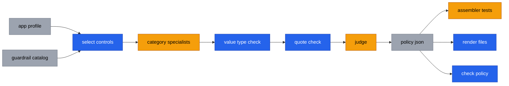

# docker-agent-prisma-cortex

Generate advisory, source-cited AI guardrail policies, and answer Prisma Cloud / Cortex Cloud questions from official documentation.

> Independent project. Not affiliated with Palo Alto Networks, Docker, NVIDIA, AWS, OWASP or MITRE.

## What this is

Two command-line tools on one shared engine ([docker-agent](https://github.com/docker/docker-agent), Ollama cloud models, a script quote check and a cross-family judge):

- **Guardrail policy generator.** Turns a sanitized app profile into an advisory `policy.json`, tests and Bedrock / NeMo drafts. Each value is marked as vendor-grounded or as a catalog default.
- **Docs briefing.** Answers a Prisma Cloud / Cortex Cloud question with a short briefing in which every statement cites an official page.

## Requirements and cloud-only

- `bash`, `curl`, `python3` 3.9+ (standard library only)
- [docker-agent](https://github.com/docker/docker-agent/releases) 1.152+
- [Ollama](https://ollama.com/download), signed in with `ollama signin`, and internet access

All models run on Ollama cloud; model names end in `:cloud` or `-cloud`. Nothing is downloaded locally. A startup guard rejects local models (exit 64) unless you set `ALLOW_LOCAL_MODELS=1`; it is off by default. Prompts and profiles are sent to ollama.com, so use sanitized profiles only: no secrets, customer or tenant data.

## Quick start (no model calls)

```bash
git clone https://github.com/arifbazli/docker-agent-prisma-cortex.git
cd docker-agent-prisma-cortex
cp .env.example .env
python3 -m unittest discover -s tests
python3 scripts/guardrail.py --no-llm bench/guardrail/rag-chatbot.profile.json
ls "$(cat outputs/.last-guardrail)"
```

`--no-llm` builds the policy from catalog defaults only (every selected control is `catalog-default`), then runs the renderers and `scripts/check-policy.py`. Outputs land in `outputs/<timestamp>-guardrail-<profile>/`; `outputs/.last-guardrail` holds the latest path. `--dry-run` prints the selected controls and specialist prompts without calling a model.

### With models

```bash
python3 scripts/guardrail.py bench/guardrail/rag-chatbot.profile.json
scripts/run.sh "Why migrate from Prisma Cloud to Cortex Cloud?"
```

A live guardrail run takes several minutes per profile; a briefing takes a few minutes.

## How it works



Amber steps (LLM) and their model settings:

| Amber step | Model setting |
|---|---|
| category specialists | `SPECIALIST_MODEL` |
| judge | `JUDGE_MODEL` |
| assembler tests | `REVIEWER_MODEL` |

Blue = script, amber = LLM step (with its model variable), grey = data.

- Scripts select the controls and verify that each quote is on the cited page.
- LLMs only propose parameter values and write tests.
- A judge from a different model family checks that the quote supports the value.

More diagrams: [docs/architecture.md](docs/architecture.md). Details: [docs/guardrail-generator.md](docs/guardrail-generator.md).

## Example output

Trimmed from a live run on the `rag-chatbot` golden profile (`policy.json`):

```json
{
  "control_id": "INPUT-10",
  "name": "Injection screening",
  "tier": "grounded",
  "parameters": [
    {
      "name": "prompt_attack_strength",
      "value": "LOW",
      "basis": "vendor-grounded",
      "source_kind": "documented-limit-or-enum",
      "source_url": "https://docs.aws.amazon.com/bedrock/latest/userguide/guardrails-content-filters.html",
      "source_quote": "Select None, Low, Medium, or High for the level of filtration you want to apply to each category."
    },
    {
      "name": "injection_action",
      "value": "reject",
      "basis": "catalog-default",
      "label": "opinionated baseline, not vendor-backed"
    }
  ]
}
```

From the same run's `exceptions.md`:

```text
| Tier | Controls |
|---|---|
| grounded (quote verified on the vendor page and judged SUPPORTED) | 9 |
| catalog-default (catalog baseline values only, NOT vendor-backed) | 38 |
| excluded (not applicable to this profile) | 23 |

Parameters: 11 vendor-grounded, 65 catalog-default (opinionated baseline, not vendor-backed).
```

## Evidence tiers

| Tier | Meaning |
|---|---|
| `grounded` | At least one value has a vendor quote that was found on the page and judged SUPPORTED. Each such value carries a `source_kind`. |
| `catalog-default` | Values come from the catalog's recommended defaults: an opinionated baseline, not vendor-backed. |
| `excluded` | The control does not apply to this profile; the reason is recorded. |

Values with `source_kind: example-config` come from a vendor example block. They are examples, not recommendations.

## Measured results

Grounded controls out of selected controls, min-max across all 12 runs in [bench/guardrail/results.tsv](bench/guardrail/results.tsv) (4 per golden profile, default models). Counting unit: controls.

| Golden profile | Selected controls | Grounded (min-max) |
|---|---|---|
| `rag-chatbot` | 47 of 70 | 4-12 |
| `tool-agent` | 36 of 70 | 3-7 |
| `memory-assistant` | 45 of 70 | 3-11 |

Results vary between runs. Most of a policy is `catalog-default`.

## Outputs

Each run writes to `outputs/<timestamp>-guardrail-<profile>/`:

| File | Content |
|---|---|
| `policy.json` | Canonical policy with tiers, values, sources and source kinds |
| `exceptions.md` | Tier counts, waivers, catalog-default controls, dropped proposals |
| `tests.jsonl` | At least one test case per selected control |
| `evidence.json` | Counts, verdicts, timings and the `check-policy.py` result |
| `review.json` | Reviewer findings (empty with `--no-llm`) |
| `bedrock-guardrail.json`, `bedrock-report.md` | Amazon Bedrock Guardrails draft; the report lists what was not rendered |
| `nemo-config.yml`, `nemo-report.md` | NVIDIA NeMo Guardrails draft; the report lists what was not rendered |

## Settings

Set in `.env` or on the command line (the command line wins).

| Variable | Default |
|---|---|
| `SPECIALIST_MODEL` | `nemotron-3-nano:30b-cloud` |
| `JUDGE_MODEL` | `gpt-oss:120b-cloud` |
| `REVIEWER_MODEL` | `nemotron-3-super:cloud` |
| `RESEARCH_MODEL` / `WRITER_MODEL` | `nemotron-3-super:cloud` |
| `OLLAMA_BASE_URL` | `http://localhost:11434/v1` |

Full list (including `GUARDRAIL_PARALLEL`, `SAFETY`, `MODE`, `CFG`, `ALLOW_LOCAL_MODELS`): [docs/settings.md](docs/settings.md).

## Docs briefing tool

Ask about Prisma Cloud or Cortex Cloud, for example migrating from Prisma Cloud to Cortex Cloud. A researcher model extracts facts with quotes from official pages, a script checks each quote, a judge checks support, and a writer uses supported facts only.

```bash
scripts/run.sh "Why migrate from Prisma Cloud to Cortex Cloud?"
```

Configs, Docker usage, output and exit codes: [docs/docs-briefing.md](docs/docs-briefing.md). The read-only tenant assistant is experimental and untested against a live tenant; see [docs/docs-briefing.md](docs/docs-briefing.md#tenant-assistant-experimental).

## Making changes

`agents/*.yaml` are generated; never edit them by hand. Edit the sources instead:

- Docs briefing: `templates/agent.yaml.tmpl`, `templates/scopes/*-hub.txt`, `seeds/*.txt`
- Guardrail generator: `templates/guardrail-agent.yaml.tmpl`, `templates/scopes/guardrail-*.txt`, `seeds/guardrail-catalog.json`, `schemas/`

Then regenerate and test:

```bash
python3 scripts/gen-configs.py
python3 -m unittest discover -s tests
bench/guardrail/check-golden.sh
```

`check-golden.sh` makes no model calls. Live benchmarks: `bench/guardrail/run-live.sh` (guardrail) and `bench/run-all.sh` (briefing). Compare new rows in the `results.tsv` files with earlier rows before merging. Expected answers belong in `bench/`, not in prompts.

## Limitations and roadmap

- Output is advisory. A human must review every control, value and test before use.
- Grounding varies between runs; treat one run as a draft.
- The judge can pass weak values. Value-type checks (type, range, enum, number in quote) reduce this but do not remove it.
- A partly supported proposal is dropped, not partly applied.
- Bedrock denied topics need human-written definitions.
- MITRE ATLAS links point to the site root.
- Prisma AIRS grounding is thin.

Roadmap: extract enums and ranges from vendor API schemas; make the tenant assistant template cloud-only; rename the repository.

## License

[MIT](LICENSE)
