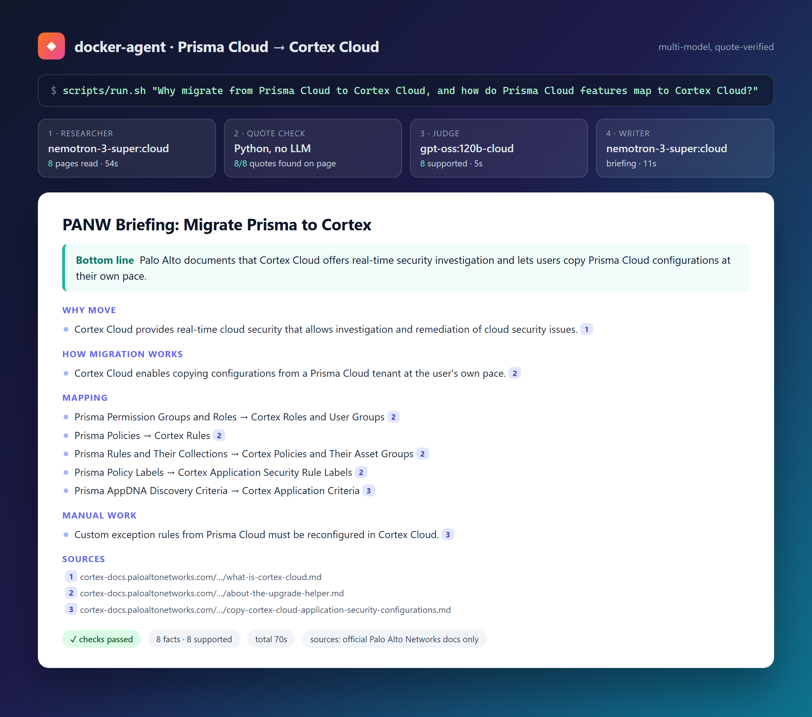
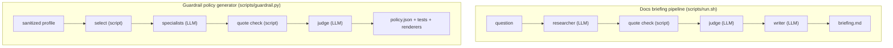

# docker-agent-prisma-cortex

> Independent project. **Not affiliated with** Palo Alto Networks, Docker, NVIDIA,
> AWS, OWASP or MITRE. Prisma Cloud, Cortex Cloud, Pan.dev, NVIDIA NeMo,
> Amazon Bedrock, OWASP (including the LLM Top 10) and MITRE ATLAS are
> trademarks or projects of their respective owners; links below point at the
> official sources.

Two small toolkits that sit on top of [docker-agent](https://github.com/docker/docker-agent)
and [Ollama](https://ollama.com) cloud models:

- **Docs briefing pipeline** - answers a question about Prisma Cloud / Cortex Cloud
  from official documentation, with every statement tied to a quote a script
  checked against the page.
- **Guardrail policy generator** - turns a *sanitized* app profile into an
  advisory guardrail policy (`policy.json`), per-control tests, and
  Bedrock / NeMo renderings.





## Cloud-only note (both toolkits)

All default models end in `:cloud` and run on `ollama.com`. You need:

- `ollama signin` (or `OLLAMA_API_KEY` set), and internet access.
- Any input you send, including profiles, briefings and URLs, is sent to the
  model provider. **Use sanitized profiles only** - no secrets, customer or
  tenant data.
- Local models are refused (`local models are disabled; use a cloud model`) unless
  `ALLOW_LOCAL_MODELS=1` is explicitly set in the environment by you.

---

## Docs briefing pipeline

Ask about Prisma Cloud or Cortex Cloud (especially migrating from Prisma Cloud
to Cortex Cloud) and get a short briefing built only from official documentation.
Every statement cites a page. About 1-3 minutes per question.

### Quick start

Needs `bash`, `curl`, `python3` 3.9+,
[docker-agent](https://github.com/docker/docker-agent/releases) 1.152+ and
[Ollama](https://ollama.com/download).

```bash
ollama signin
git clone https://github.com/arifbazli/docker-agent-prisma-cortex.git && cd docker-agent-prisma-cortex
cp .env.example .env
python3 -m unittest discover -s tests
scripts/run.sh "Why migrate from Prisma Cloud to Cortex Cloud?"
```

More examples:

```bash
CFG=agents/cortex-cloud-hub.yaml scripts/run.sh "What does Cortex Cloud AI-SPM monitor?"
JUDGE_MODEL=gpt-oss:20b-cloud scripts/run.sh "How do I authenticate to the Cortex Cloud API?"
```

### Example output

`**Output:**` the briefing is printed and saved to `outputs/<run>.md`.
`outputs/<run>.evidence.json` holds each fact, quote and verdict.
Check **To confirm** items yourself. One-line special results: `OUT OF SCOPE`,
`NO FACTS FOUND`, `BRIEFING FAILED` (see `logs/`). Exit codes: `0` ok,
`1` failed checks, `2` step failed.

### Docker

```bash
cp .env.example .env && printf 'HOST_UID=%s\nHOST_GID=%s\n' "$(id -u)" "$(id -g)" >> .env
mkdir -p outputs logs fetched
docker compose run --rm --build agent "Why migrate from Prisma Cloud to Cortex Cloud?"
```

Uses Ollama on the host. Prebuilt image:
`ghcr.io/arifbazli/docker-agent-prisma-cortex:latest`. See [`compose.yaml`](compose.yaml)
to run Ollama in a container.

### Settings

Set in `.env` or on the command line (the command line wins).

| Variable | Default |
|---|---|
| `OLLAMA_BASE_URL` | `http://localhost:11434/v1` |
| `RESEARCH_MODEL` / `WRITER_MODEL` / `ROUTER_MODEL` | `nemotron-3-super:cloud` |
| `JUDGE_MODEL` | `gpt-oss:120b-cloud` |
| `CFG` | `agents/prisma-cortex-hub.yaml` |
| `MODE` | `pipeline` (`agent` = run everything inside docker-agent) |
| `SAFETY` | `restricted` |

---

## Guardrail policy generator

Generates a `policy.json` for an app profile by (a) selecting the applicable
controls from the 70-control catalog, (b) grounding each parameter in vendor
documentation with an evidence tier, and (c) rendering Bedrock and NeMo drafts.

Strengths of the approach:

- **Deterministic control selection.** `select-controls.py` evaluates each catalog
  control's rule against the profile; no model decides which controls apply.
- **Coverage with explicit waivers.** Every category is covered or waived with a
  reason; no silent gaps.
- **Per-control tests.** Each selected control gets at least one test case.
- **Evidence tiers.** A control is `grounded` only when a vendor quote survived
  the quote check and a cross-family judge, `catalog-default` when only the
  catalog baseline is used. The output never hides which is which.
- **Renderers refuse unsupported values.** Bedrock and NeMo drafts only contain
  values that map to a real target field; everything else is listed as not rendered.
- **Advisory output.** `policy.json` carries `advisory: true`; nothing is claimed to
  be safe to deploy without review.

### Quick start

```bash
git clone https://github.com/arifbazli/docker-agent-prisma-cortex.git && cd docker-agent-prisma-cortex
cp .env.example .env
python3 scripts/gen-configs.py
python3 -m unittest discover -s tests
python3 scripts/guardrail.py --no-llm bench/guardrail/rag-chatbot.profile.json   # no model calls
python3 scripts/check-policy.py "$(cat outputs/.last-guardrail)/policy.json" \
  --tests "$(cat outputs/.last-guardrail)/tests.jsonl" \
  --expected bench/guardrail/rag-chatbot.expected.json
```

With cloud models (uses the models in `.env`):

```bash
python3 scripts/guardrail.py bench/guardrail/rag-chatbot.profile.json
bench/guardrail/check-golden.sh
```

### Example output (rag-chatbot gold profile, default model, 3 runs)

Measured counting unit: **controls** (47 selected out of 70; excluded controls
carry a reason; 20 categories waived only when a category has no applicable control).

| Run | Grounded controls | Vendor-grounded parameters |
|---|---|---|
| 1 | 4  | 6  |
| 2 | 12 | 13 |
| 3 | 7  | 9  |

Range across the three runs: **4-12 grounded controls** (median 7).
Most of a policy is `catalog-default` - an opinionated baseline from
`recommended_defaults`, not vendor-backed. Golden-profile checks
(`bench/guardrail/check-golden.sh`) pass; a mutation check on each run catches a
removed control, a duplicate, a mistyped value, or a default trying to cite a source.

### Example output files

Under `outputs/<run>/`:

- `policy.json` - canonical, schema-validated, with evidence tiers and source kinds
- `exceptions.md` - tiers, waivers, dropped proposals and why, reviewer findings
- `tests.jsonl` - at least one test per selected control
- `bedrock-guardrail.json` / `bedrock-report.md`
- `nemo-config.yml` / `nemo-report.md`
- `review.json`, `evidence.json`

### Limitations

- Output is **advisory**. A human must review every control, parameter and test
  before use.
- **Grounding variance.** Cloud model output varies between runs (see ranges above);
  treat a single run as a draft.
- **Example-config values are not recommendations.** When a value is taken from a
  vendor example block (`source_kind: example-config`), it is labelled
  `example from vendor docs, not a recommendation`.
- **The judge can pass weak values.** Value-type checks (type, range, enum, and
  number-in-quote) reduce this but do not eliminate it.
- **Partly supported proposals are dropped** rather than partially applied.
- **Bedrock denied topics** need a human-written definition per topic.
- **ATLAS links** point at the site root (no stable deep links).
- **Prisma AIRS grounding is thin** (documentation lives behind JavaScript rendering;
  we use the pan.dev source).
- `catalog-default` values are an opinionated baseline, not vendor-backed. Review
  each one, especially where no `recommended_defaults` entry exists (the renderer
  lists those as `configure by hand`).

### Settings (guardrail)

| Variable | Default |
|---|---|
| `SPECIALIST_MODEL` | `nemotron-3-nano:30b-cloud` |
| `JUDGE_MODEL` | `gpt-oss:120b-cloud` |
| `REVIEWER_MODEL` | `nemotron-3-super:cloud` |
| `GUARDRAIL_PARALLEL` | `4` (max 7) |
| `GUARDRAIL_BACKOFF_SECONDS` | `5` (exponential, max 3 retries) |
| `GUARDRAIL_CONTEXT_CHARS` | `24000` |
| `GUARDRAIL_CACHE_DAYS` | `7` (start-page cache under `fetched/guardrail/`) |

### Roadmap

- Deterministic extraction of enums and ranges from API reference schemas.
- Harmonize the tenant assistant template with the cloud-only rule (separate PR).

---

## Tenant assistant (experimental)

Read-only questions about your own Prisma Cloud / Cortex Cloud tenants. Fill the
`PRISMA_*` and `CORTEX_*` values in `.env` with **read-only** keys, then:

```bash
scripts/gen-tenant-config.sh && eval "$(scripts/prisma-login.sh)"
docker-agent run --exec --env-from-file .env agents/tenant-readonly.local.yaml "List my cloud accounts in both tenants"
```

Not yet tested against a live tenant. Tenant data is sent to the model provider.

## Making changes

`agents/*.yaml` are generated; do not edit them. For the docs briefing, edit
`templates/agent.yaml.tmpl`, `templates/scopes/*.txt` or `seeds/*.txt`. For the
guardrail generator, edit `seeds/guardrail-catalog.json`, `schemas/`,
`scripts/guardrail*.py`, `scripts/check-policy.py`, `scripts/render-*.py` or
`templates/guardrail-agent.yaml.tmpl`. Then:

```bash
git checkout -b my-change
python3 scripts/gen-configs.py                  # regenerate agents/*.yaml
python3 -m unittest discover -s tests
scripts/check-seeds.sh                           # nightly seed-URL check
bench/guardrail/check-golden.sh                  # guardrail golden + mutations
bench/run-all.sh                                 # ~25 min, appends to bench/results.tsv
git commit -am "..." && git push -u origin my-change   # open a PR; CI must pass
```

Compare new `bench/.../results.tsv` rows with the previous ones before merging.
Put expected answers in `bench/questions.txt`, not in prompts. Keep doc examples
honest about what a single run proves.

## Layout

```
agents/        generated configs                  templates/   prompt templates
docs/          architecture.md                    scripts/     pipeline, checks, generators
seeds/         start pages + catalog              tests/       unit tests (no model calls)
bench/         benchmarks + results.tsv           bench/guardrail/ golden profiles + checks
fetched/       cached pages (gitignored)
outputs/       briefings + policies (gitignored)
logs/          run logs (gitignored)
```

## Safety and limitations

- Agents can only fetch pages from `cortex-docs.paloaltonetworks.com`,
  `docs.paloaltonetworks.com`, `www.paloaltonetworks.com`, `docs.prismacloud.io`,
  `pan.dev`, `docs.aws.amazon.com`, `docs.nvidia.com`, `genai.owasp.org` and
  `atlas.mitre.org`. Write, exec and shell tools are denied.
- Answers and policies are only as current as the cited docs.
- If a run fails, rerun once (models vary). Connection errors: check Ollama and
  `OLLAMA_BASE_URL`. `401` from a `:cloud` model: `ollama signin`.

## License

[MIT](LICENSE)
