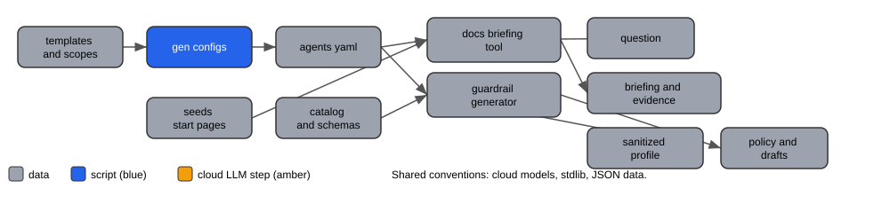
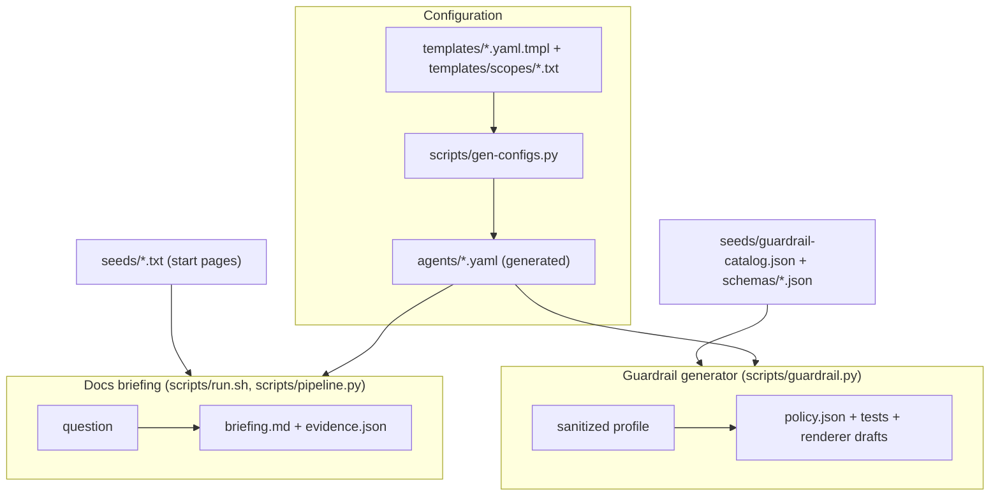
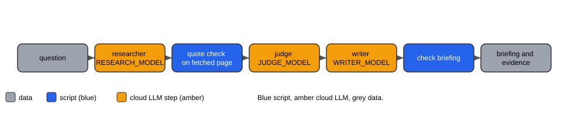

# Architecture

Back to the [README](../README.md). The guardrail pipeline diagram is in the README;
step details are in [guardrail-generator.md](guardrail-generator.md).

Both tools share the same conventions: Ollama cloud models only, standard-library
Python, source pages fetched by scripts, JSON data files, generated agent configs.

## Repository overview

Mermaid source

## Docs briefing pipeline

Blue = script, amber = LLM step (with its model variable), grey = data.

Amber steps (LLM) and their model settings:

| Amber step | Model setting |
|---|---|
| Researcher | RESEARCH_MODEL |
| Judge | JUDGE_MODEL |
| Writer | WRITER_MODEL |

Legend: amber = cloud LLM step, blue = script, grey = data.

Mermaid source

`MODE=agent` replaces the scripted steps with a root agent on `ROUTER_MODEL` inside
docker-agent. Details: [docs-briefing.md](docs-briefing.md).
