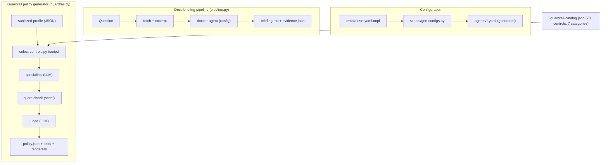
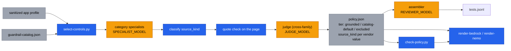

# Architecture

This repository holds two related things:

1. **Docs briefing pipeline** (`scripts/run.sh` + `scripts/pipeline.py` +
   docker-agent): turn a question into a cited research brief.
2. **Guardrail policy generator** (`scripts/guardrail.py` and friends): turn a
   sanitized app profile into an advisory `policy.json`, tests and renderer reports.

Both share the same conventions: cloud-only Ollama models, stdlib Python only,
script-fetched sources, JSON data files.

## Repository overview

## Guardrail policy pipeline

Steps are colour coded: blue = script, amber = LLM, grey = data.

## Evidence tiers

- **grounded**: at least one parameter is vendor-grounded (quote verified on the
  cited page and judged SUPPORTED). Vendor values override the catalog default
  for the same key.
- **catalog-default**: every parameter is a catalog `recommended_defaults`
  entry (opinionated baseline, NOT vendor-backed) or there are none.
- **excluded**: catalog control not selected for this profile, with a reason.

## Source kinds (per vendor value)

- `documented-default`: page states the default for the setting
- `documented-limit-or-enum`: page lists limits or allowed options and one was chosen
- `example-config`: value only appears inside an example/sample config block (forced by
  script when the quote sits in such a block). These are examples, not recommendations.
- `other`: none of the above
